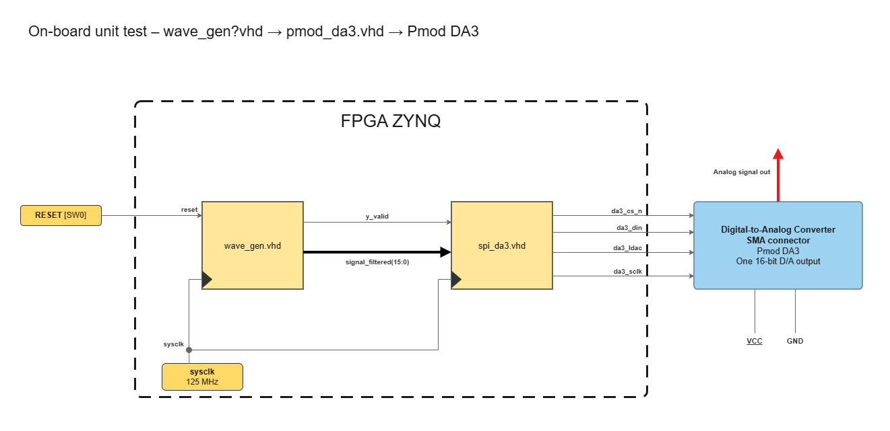

# Simulation

The design is verified block by block, starting with the DAC driver `pmod_da3`. Each block is simulated on its own with a dedicated testbench, then tested on the board, before being integrated into the full chain. This is the unit-test level of the V-cycle described in the [main README](../README.md).

| File | Role |
| --- | --- |
| [`pmod_da3.vhd`](../rtl/final_design/pmod_da3.vhd) | Block under test: SPI driver of the Pmod DA3 |
| [`tb_pmod_da3.vhd`](tb_pmod_da3.vhd) | Its testbench |

## 1. pmod_da3

### Simulation

The test is validated graphically on the waveform, and above all by assertions. The testbench is self-checking: it reports an error as soon as a check fails and prints `*** TEST PASSED ***` only if every check succeeded.

In the red boxes, the word captured on the SPI bus equals the expected word at the end of each frame. The console shows `TEST PASSED`.

### Validation on the board

Once the simulation passed, the block was tested on the Zybo Z7-10. A test generator (`wave_gen`) feeds the Pmod DA3, and the signals are observed with the Analog Discovery 3.

For this test, `wave_gen` produces a square wave that stands in for the filtered signal, so the DAC driver is checked without the FIR filter.

**DA3 output**: a 50 Hz square wave between 0 V and about 2.5 V (49.999 Hz and 50 % duty cycle measured).

**SCLK**: one burst of 16 clock pulses per sample, one for each data bit. The bursts repeat every sample period (about 208 µs, 4.8 kHz).

**Limit of this test**: a square wave only uses two output values, so it proves the frame, the clock and the two extreme levels, but not the other codes. A sine wave or a ramp would have been a better stimulus: it sweeps all the output codes, and a stuck or swapped data bit would show up as a distortion on the analog output.

## Running the simulation

In Vivado, add [`pmod_da3.vhd`](../rtl/final_design/pmod_da3.vhd) and [`tb_pmod_da3.vhd`](tb_pmod_da3.vhd), set `tb_pmod_da3` as the top module and run the behavioral simulation (about 310 µs).