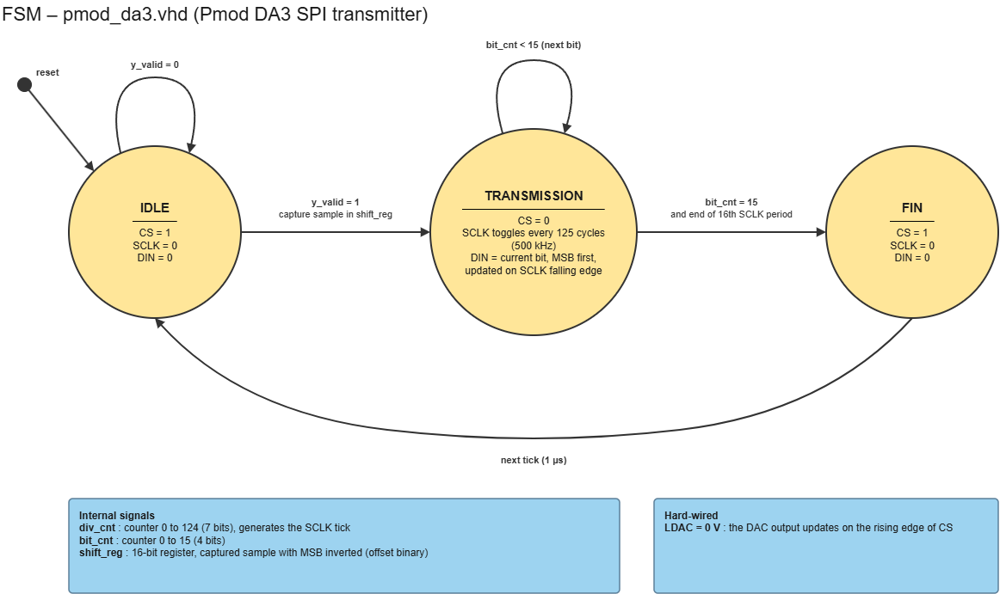

# Simulation

Each block of the design is simulated on its own before being integrated into the full chain. A block is only used in the top level once its testbench passes. This follows the unit-test level of the V-cycle described in the [main README](../README.md).

| File | Role |
| --- | --- |
| [`pmod_da3.vhd`](pmod_da3.vhd) | Block under test: SPI driver of the Pmod DA3 |
| [`tb_pmod_da3.vhd`](tb_pmod_da3.vhd) | Its testbench |

## pmod_da3

The testbench is self-checking: it uses assertions, so the simulator reports an error as soon as something is wrong and prints `*** TEST PASSED ***` at the end only if every check succeeded. No manual inspection of the waveform is needed for the pass/fail verdict.

**Block design**

**Simulation waveforms**

## Running the simulation

In Vivado, add both files, set `tb_pmod_da3` as the top module and run the behavioral simulation (about 310 µs).