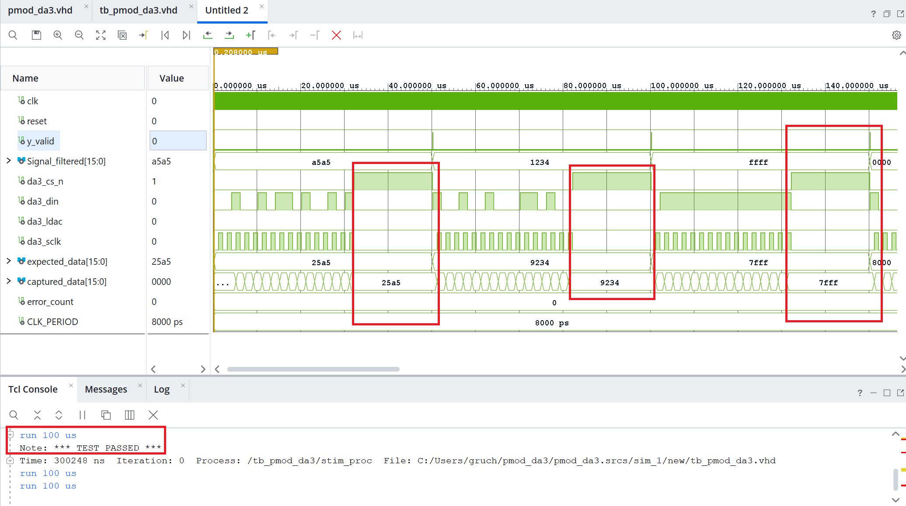
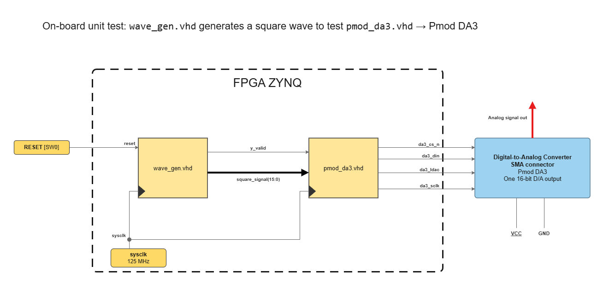
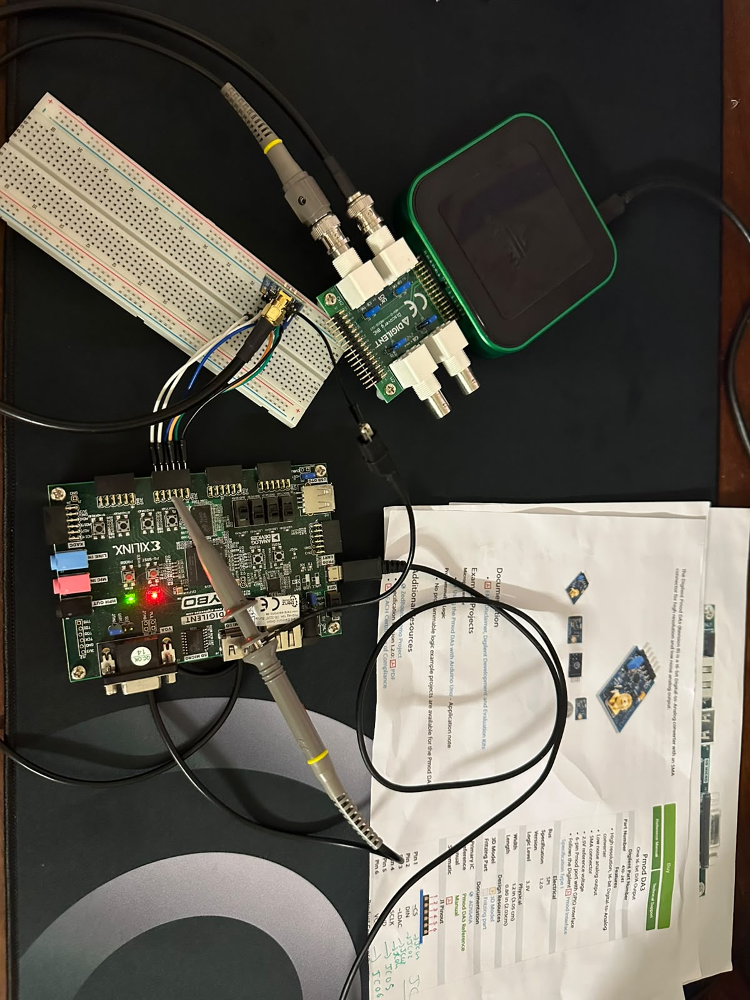
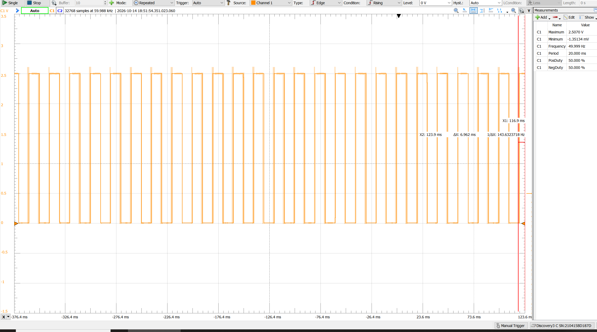
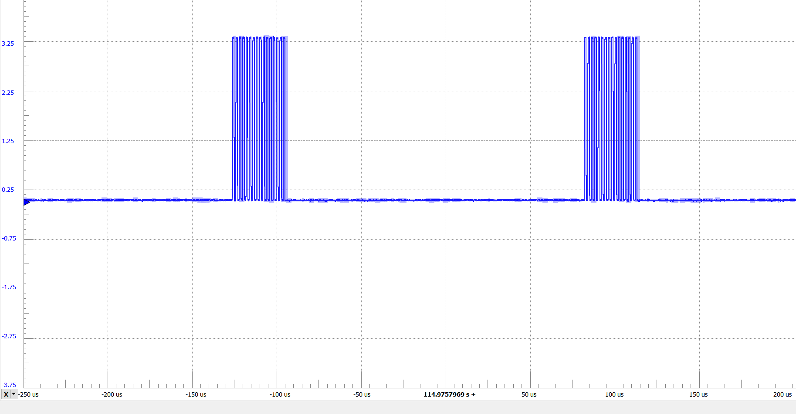

# Simulation

The design is verified block by block. Every block of the final architecture is simulated on its own, then tested in real conditions on the board, before the final design is implemented. This is the unit-test level of the V-cycle described in the [main README](../README.md).

The blocks circled in red in the diagram below are the ones covered in this folder.

The tests start with the DAC driver `pmod_da3`.

| File | Role |
| --- | --- |
| [`pmod_da3.vhd`](../rtl/final_design/pmod_da3.vhd) | Block under test: SPI driver of the Pmod DA3 |
| [`tb_pmod_da3.vhd`](tb_pmod_da3.vhd) | Its testbench |

## 1. pmod_da3

### Simulation

The test is validated graphically on the waveform, and above all by assertions. The testbench is self-checking: it reports an error as soon as a check fails and prints `*** TEST PASSED ***` only if every check succeeded.

In the red boxes, the word captured on the SPI bus equals the expected word at the end of each frame. The console shows `TEST PASSED`.

### Validation on the board

Once the simulation passed, the block was tested on the Zybo Z7-10. A test generator (`wave_gen`) feeds the Pmod DA3, and the signals are observed with the Analog Discovery 3.

For this test, `wave_gen` produces a square wave that stands in for the filtered signal, so the DAC driver is checked without the FIR filter.

First real test on the board: the analog output of the Pmod DA3 goes through its SMA connector to channel 1 of the Analog Discovery 3. A probe on channel 2, with its ground lead connected, is placed on the Pmod header pins one at a time to observe the SPI signals (SCLK, DIN, …).

  

**DA3 output**: a 50 Hz square wave between 0 V and about 2.5 V (49.999 Hz and 50 % duty cycle measured).

**SCLK**: one burst of 16 clock pulses per sample, one for each data bit. The bursts repeat every sample period (about 208 µs, 4.8 kHz).

**Limit of this test**: a square wave only uses two output values, so it proves the frame, the clock and the two extreme levels, but not the other codes. A sine wave or a ramp would have been a better stimulus: it sweeps all the output codes, and a stuck or swapped data bit would show up as a distortion on the analog output.

## Running the simulation

In Vivado, add [`pmod_da3.vhd`](../rtl/final_design/pmod_da3.vhd) and [`tb_pmod_da3.vhd`](tb_pmod_da3.vhd), set `tb_pmod_da3` as the top module and run the behavioral simulation (about 310 µs).